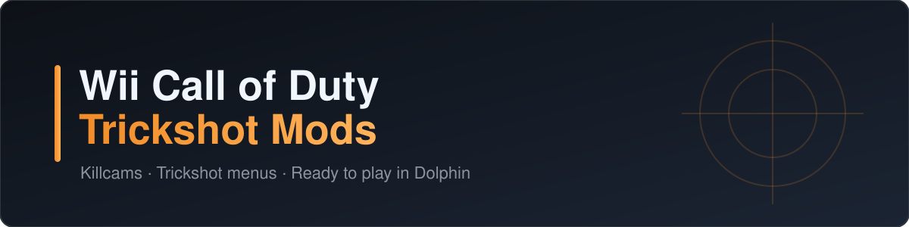

  

  
  
  
  

Trickshot mod menus with console-style killcams for four Wii Call of Duty games, played in Dolphin on a Windows PC.
Every download is a ready-to-run folder with its own copy of Dolphin. **No game is included**: the setup builds the
modded game from your own copy, and your game file is never changed.

## Downloads

Grab the zip for your game from **[Releases](../../releases/latest)**. Each game comes in two versions:

| Version | Pick it if... |
|---|---|
| **Xbox-Controls** | you play with an Xbox controller and want a ready-made button layout |
| **Own-Controls** | you already set up your controller in your own Dolphin and want to keep those buttons |

| Game | Guide | Your game file | Downloads |
|---|---|---|---|
| **Black Ops** | [Guide](docs/black-ops.md) | USA · `SC7E52` | `BO1-Trickshot-Xbox-Controls.zip` · `BO1-Trickshot-Own-Controls.zip` |
| **World at War** | [Guide](docs/world-at-war.md) | USA, first release · `RVYE52` | `WaW-Trickshot-Xbox-Controls.zip` · `WaW-Trickshot-Own-Controls.zip` |
| **Modern Warfare: Reflex** | [Guide](docs/reflex.md) | USA, first release · `RJAE52` | `CoD4-Trickshot-Xbox-Controls.zip` · `CoD4-Trickshot-Own-Controls.zip` |
| **Modern Warfare 3** | [Guide](docs/modern-warfare-3.md) | USA, first release · `SM8E52` | `MW3-Trickshot-Xbox-Controls.zip` · `MW3-Trickshot-Own-Controls.zip` |

Game files can be `.wbfs`, `.iso` or `.rvz`.

## Quick start

1. **Download** the zip, right-click it > **Properties** > tick **Unblock** > **OK**, then right-click > **Extract All**.
2. **Set up:** open the folder and double-click **`1 - SETUP (run once).cmd`**. Pick your game file and answer the
   questions.
3. **Play:** double-click **`2 - PLAY ... .cmd`**. From then on, that's all you need.

Every folder also has a **`READ ME.txt`** with the full guide for that game.

## Features

| | Black Ops | World at War | Reflex | MW3 |
|---|:---:|:---:|:---:|:---:|
| Final killcam (TDM / FFA) | ✓ | ✓ | ✓ | ✓ |
| Round-winning killcam (Search & Destroy) | ✓ | ✓ | ✓ | ✓ |
| Trickshot menu + bots | ✓ | ✓ | ✓ | ✓ |
| Fast Last · Unlimited Time | ✓ | ✓ | ✓ | ✓ |
| Save / Load position (prone binds) | ✓ | ✓ | ✓ | ✓ |
| UFO mode | ✓ | ✓ | ✓ | ✓ |
| Account menu (level, prestige, unlock all) | ✓ | ✓ | ✓ | ✓ |
| Rocket riding · Death barriers on/off | ✓ | ✓ | ✓ | Barriers |
| Extras | Steady Aim Pro switch | | Xbox-style Classic Controller | Spots menu, own online server |

Open the menu in a match: **crouch, then hold your knife button**.

## Requirements

- Windows PC, about 4–5 GB free space per game.
- Your own Wii game file (USA version, see the table).
- **Black Ops, World at War, Reflex:** your Wii NAND from your own Dolphin (the setup finds it). MW3 doesn't need one.
- An Xbox controller for the Xbox-Controls versions, or your controller already set up in Dolphin for Own-Controls.

## Good to know

- Use the mods in **your own private matches**. For normal online games, use your normal copy of the game.
- To update, download the new zip and run **`1 - SETUP`** again. Your saves stay.

## Credits

- [Dolphin](https://dolphin-emu.org/): the Wii emulator in every download (GPL-2.0-or-later, source at
  [github.com/dolphin-emu/dolphin](https://github.com/dolphin-emu/dolphin)).
- [CodN](https://codn.live/): the community client for Black Ops.
- The World at War and Reflex community servers.

*Fan project. Not affiliated with or endorsed by Activision, Nintendo, or any of the projects above.*
